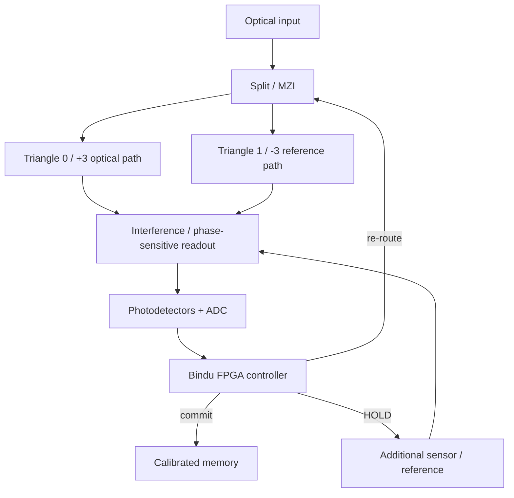

# 06 — Пропонований фотонний осередок Sri / Flower v0.1

## Мета

Створити програмований гібридний оптоелектронний пристрій для **конкретної** задачі: розпізнати дві хвильові моди або спектральні класи, вибрати потрібний маршрут та за потреби зробити додаткове фазочутливе вимірювання.

## Апаратні блоки

1. **Optical input:** джерело когерентного сигналу / зовнішній вимірюваний вхід, стабілізація потужності.
2. **Split & Route:** хвилевідний розгалужувач і комутатори (MZI/кільцеві елементи) для двох маршрутів `0` і `1`.
3. **+3 triangle:** три фізичні ділянки поширення/інтерференції або еквівалентні програмовані оптичні порти.
4. **−3 triangle:** три ділянки контролю фази, порівняння і повернення сигналу.
5. **Phase references:** оптичний опорний шлях або фазочутлива детекція; без цього не відрізнити +3 та −3 у тесті aliasing.
6. **Photodetectors / ADC:** переводять світло в електричний результат.
7. **Electronic Bindu/FPGA:** пороги, калібрування, захист від невизначеності, вибіркове перемикання, `ALLOW/HOLD/BLOCK/REWRITE`.
8. **Local memory:** зберігає маршрути, коефіцієнти фаз, історію вимірювань, аудит.
9. **Power/thermal:** облік енергії лазера, модуляторів, детекторів, ADC/DAC, контролера і температурної стабілізації.

## Трикутники 0/1

- **Логічне значення:** маршрут 0 або 1 — dual-rail кодування.
- **Хвильовий режим:** обидва шляхи можуть бути одночасно заповнені світлом з певною амплітудою і фазою.
- **Зворотний зв'язок:** Bindu перемикає фазові модулятори, але це не безпосереднє квантове вимірювання електрона.

## Чому це не «готовий AI-чіп»

Оптична частина реалізує спеціалізовані лінійні/фазові операції. Для нелінійної логіки, зберігання ваг, оновлення пам'яті й перевірок зазвичай потрібна електроніка або спеціальні нелінійні матеріали. Режим автоматичного навчання не виникає тільки через резонанс.

## Критичні фізичні витрати

Втрати на вставку кожного оптичного елемента, когерентність, фазовий дрейф, переходи електрика↔оптика, енергія модуляції, лазера та охолодження, перехресні перешкоди. Порівняння проводити в джоулях на **правильно класифікований** сигнал.

## Масштабування

Після доказу двомаршрутного осередку — шість портів, додатковий зсунутий датчиковий пояс, локальні Bindu і 14/10/10/8 як програмна маршрутизація. FPGA перед ASIC, як і в `v-kernel/docs/FPGA_BRIDGE.md`.
