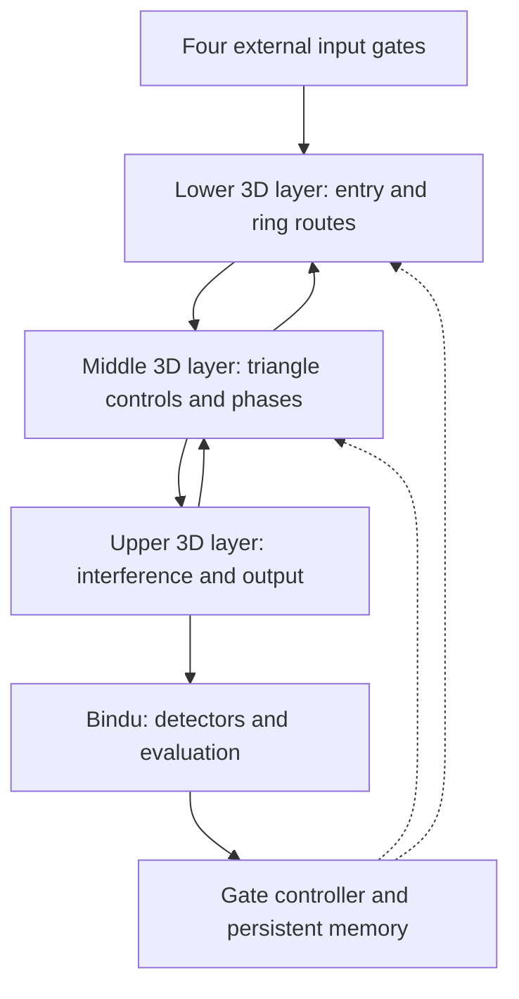
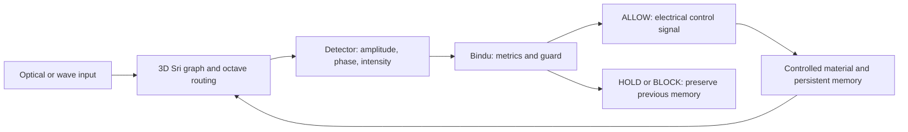

# 241 — 3D Sri–Octave Phase Routing: From the +3/−3 Flower to Wave Computing and an Atomic-State Hypothesis

**Project:** Vuzol-19 / World Theory / V-Kernel  
**Suggested GitHub path:** `world_theory/241_3D_SRI_OCTAVE_PHASE_ROUTING_ATOM_HYPOTHESIS_EN.md`  
**Status:** `RESEARCH / ARCHITECTURAL MODEL / TESTABLE HYPOTHESIS / NOT VERIFIED ATOMIC PHYSICS`  
**Date:** 2026-10-19  
**Document language:** English  
**Keywords:** Flower Gate, Sri Yantra, 3D Sri Cube, phase routing, +3/−3, octaves, optical waveguides, interference, Bindu, Shadow, observability, material memory, atomic transitions.

> **Core thesis:** The 3D Sri graph specifies **where** routes can exist; octaves specify **at what functional or spectral level** they operate; +3/−3 specifies **which graph transition** is requested; phase determines **how wave amplitudes combine**; and Bindu/Gate determines **what is measured, accepted, and, when an actuator is available, stored as a persistent update**.

> **Scientific boundary:** This document develops a **candidate architecture for programmable wave computing** and a **conceptual graph language for comparing atomic transitions**. There is no experimental evidence that an atomic nucleus literally contains a Sri Yantra, that nucleons act as steerable optical phased-array antennas, or that quantum uncertainty results from hidden +3/−3 routing. Engineering experiments and atomic-physics tests must be evaluated separately.

## Abstract

This document defines a layered, phase-programmable graph architecture inspired by the Sri Yantra and the Flower's +3/−3 rule. Binary triangle controls select local routing modes, three-dimensional interlayer links provide spatial connectivity, and octaves provide explicitly defined functional or spectral indices. A Bindu controller reads outputs, evaluates constraints and residual errors, and allows or rejects updates to persistent memory. The engineering proposal can be tested against conventional programmable photonic meshes using transmission fidelity, loss, observability, stability, switching cost, and reproducibility. An analogy with proton–neutron structure and atomic spectra is included only as a hypothesis-generation tool; a genuine atomic theory would require a defined Hamiltonian, selection rules, and new spectroscopic predictions that survive independent validation.

---

## 0. Truth Gate: FACT / MODEL / HYPOTHESIS / HOLD / BLOCK

| Label | Statement |
| --- | --- |
| **FACT** | Phase shifters and Mach–Zehnder interferometers (MZIs) can control optical amplitude distributions in programmable photonic meshes. |
| **FACT** | Atomic electronic energy levels depend on electromagnetic interactions and, more subtly, on nuclear mass, size, spin, and electromagnetic moments. |
| **FACT** | Photon frequencies, polarizations, and transition probabilities are constrained by energy differences, symmetries, matrix elements, and quantum selection rules. |
| **MODEL** | Triangles are programmable modules; edges are allowed connections; +3/−3 are graph operators; octaves are indices; Bindu is a measurement-and-decision controller. |
| **HYPOTHESIS** | A specific layered Sri-inspired topology with tunable phases, octave-aware routing, and memory might outperform appropriate control meshes on defined tasks. |
| **HOLD** | Proton = bit 1; neutron = bit 0; nucleons are optical phased arrays; 14/10/10/8 is a universal law of atomic physics. |
| **BLOCK** | Claims of instantaneous information transfer, exact classical paths of electrons inferred from the diagram, or circumvention of quantum uncertainty without proof. |

**Rule:** Geometry generates questions and algorithms. Only measurable predictions decide whether they describe a physical system.

## 1. From the original Flower to a larger architecture

Start with two mutually inverse operators on a numbered ring:

- **+3 Forward:** advance by three nodes in the selected cyclic ordering.
- **−3 Reverse / Unwind:** go backward by three nodes.
- **Triangle controls A and B:** independently enable or disable two routing modes.
- **Bindu:** an abstract readout, evaluation, and decision point.

For a demonstration ring containing eight nodes:

```math
R_{+3}|j\rangle = |(j+3)\bmod 8\rangle,
\qquad
R_{-3}|j\rangle = |(j-3)\bmod 8\rangle.
```

The +3 route is:

`0 -> 3 -> 6 -> 1 -> 4 -> 7 -> 2 -> 5 -> 0`

Because `gcd(3, 8) = 1`, it visits all eight nodes. This follows from cyclic-graph arithmetic. It is **not** an experimentally established law of photons, nucleons, or atomic energy levels.

**Constraint:** The two operators are inverse permutations. Merely drawing two opposite arrows does not create interference, resonance, lossless transport, or memory.

## 2. Two triangle controls as a four-mode gate

Two control bits, `A` and `B`, define four *commands*, not four known states of an atomic nucleus.

| A | B | Mode | Requested network behavior | Required physical implementation |
| :---: | :---: | --- | --- | --- |
| 0 | 0 | `PASSIVE / HOLD` | Preserve or isolate the selected route. | Specify whether energy is stored, reflected, absorbed, or sent elsewhere. |
| 1 | 0 | `FORWARD +3` | Route to node `j+3`. | An enabled optical path or coupling. |
| 0 | 1 | `REVERSE −3` | Route to node `j−3`. | An alternative optical path or coupling. |
| 1 | 1 | `DUAL / INTERFERENCE` | Enable both routes; control their phase difference. | Coherent fields and a defined combining element. |

For two coherent optical fields at a common readout:

```math
I = I_A + I_B + 2\sqrt{I_A I_B}\cos(\Delta\varphi).
```

Mode `11` may produce constructive interference, destructive interference, or an intermediate result. **Bindu Lock is not automatically created by two active bits.** It must be defined by a measurable criterion, for example a Bindu intensity above a chosen threshold for `K` consecutive measurement cycles, together with a stability check.

The two control bits alone are insufficient to encode an arbitrary optical phase. A practical device also needs analog or higher-resolution phase settings.

## 3. Sri Yantra as a cascade of regions and gates

A conventional geometric description of the Sri Yantra uses **nine primary intersecting triangles**: four pointing upward and five pointing downward. Their intersections define **43 triangular regions** arranged as `14 + 10 + 10 + 8 + 1`.

The Vuzol-19 mapping is a proposed *computational interpretation* of those regions:

| Region | Count | Proposed algorithmic role |
| --- | ---: | --- |
| Bhupura / outer gates | Four entrances or sides; not four additional triangles | Boundary conditions and access control. |
| Outer ring | 14 | Candidate states and coarse filtering. |
| First middle ring | 10 | Connection selection and structural grouping. |
| Second middle ring | 10 | Phase conflicts, balance, and diagnostic checks. |
| Inner ring | 8 | Candidate stable modes and invariant checks. |
| Center triangle | 1 | Integration of the final local configuration. |
| Bindu | A point, not an extra triangle | Readout, guard, and decision interface. |

These numbers classify a chosen geometry. They do **not** automatically give 42 independent physical switches, 42 energy levels, or 42 atomic spectral lines.

If all 42 noncentral triangle regions were independently equipped with binary controls, the abstract configuration space would have `2^42 = 4,398,046,511,104` bit assignments. If each independently selected one of four modes, it would have `4^42` assignments. Neither number is automatically the count of distinct physical routes or experimentally resolvable states.

## 4. From 2D to 3D: more connectivity, not more magic

Give each graph element an address `(r, j, z)`:

- `r` = the Sri ring or functional region;
- `j` = a numbered node inside that region;
- `z` = a physical routing layer or waveguide plane.

The third spatial dimension allows the following explicit engineering extensions:

1. Intralayer edges connecting nodes within a plane.
2. Interlayer paths between *physically connected* values of `z`.
3. Programmable delays, phase shifts, and coupling strengths.
4. Internal 3D configurations that have identical top-view projections.
5. Separate optical transport, electrical configuration, and memory circuits.

### 4.1 GitHub Mermaid diagram: layered photonic routing



**Text-only fallback:** `INPUT -> LOWER <-> MIDDLE <-> UPPER -> BINDU -> CONTROLLER -> network settings`.

**Observability condition:** Two internal configurations `C_A` and `C_B` may produce the same top-view projection, `P_xy(C_A) = P_xy(C_B)`, while giving different outputs under suitable additional measurements. This is an *inverse problem / observability* issue, not a proof that the Heisenberg uncertainty principle arises from missing camera angles.

## 5. Octaves: a processing index distinct from physical height

The Vuzol-19 seven-octave convention is written as `O1` through `O7`; `O0` is reserved for an input/calibration interface. This avoids confusing seven functional octaves with eight indexed stages (`O0` through `O7`).

| Level | Role in V-Kernel | Possible engineering mapping, to be tested |
| --- | --- | --- |
| O0 | Input and calibration | Signal injection, readout, and stabilization. |
| O1 | Carrier initialization | Optical or acoustic input modes. |
| O2 | Structural formation | Connection masks and local couplers. |
| O3 | Transmission and local gates | Programmable routes. |
| O4 | Supporting physical form | Waveguide structure and stability. |
| O5 | Actuation of transitions | Electrical phase controls and tuning elements. |
| O6 | High-fidelity transmission | Coherent multiport links. |
| O7 | Evaluation and retention | Invariant checks, readout, and persistent memory. |

An **octave** in the initial software model is an independently declared *functional level* `o`, which may differ from the physical coordinate `z`.

If instead octaves are literal frequencies `f`, `2f`, `4f`, and so on, the device needs real frequency conversion, phase matching, and an energy budget. A vertical jump in a waveguide stack does not, by itself, double the light frequency.

Define distinct routing operators:

```math
R_{\pm 3}: j \mapsto (j\pm 3)\bmod N,
\qquad
L_{\pm 1}: o \mapsto o\pm 1.
```

The octave operator `L` may be applied only when a valid cross-level channel exists. Connectivity across physical layers and across functional/spectral levels must be specified separately.

## 6. State representation and propagation rule

A convenient address for the proposed local state is:

```math
S_t = (r,j,z,o,g,\varphi,m)_t,
\qquad g\in\{00,10,01,11\}.
```

Here `g` is a local gate configuration, `\varphi` is phase, and `m` is a memory index. This is **an engineering state description**, not a set of experimentally established atomic quantum numbers.

Represent optical amplitudes by a complex vector `a_t` and use a physical transfer matrix:

```math
a_{t+1} = T(G_t,\Phi_t,K_t)a_t + B u_t.
```

- `G_t`: digital control settings;
- `Phi_t`: programmable phase settings;
- `K_t`: allowed coupling coefficients;
- `T`: network transfer matrix;
- `u_t`: injected signal;
- `B`: injection matrix.

For an ideal isolated lossless network, norm conservation constrains the evolution operator. A real lossy optical transfer matrix need not be unitary when only accessible output modes are represented. **Physical energy constraints must be validated for the specific network.**

Detector outputs can be modeled as:

```math
y_t = D a_t,
\qquad
I_{k,t} = |y_{k,t}|^2.
```

`D` represents output coupling/readout. Define **Shadow** as a measurement-based mismatch, not as a new force:

```math
\operatorname{Shadow}_t
= \|y_{\mathrm{target}}-y_t\|^2
+ \lambda\,\operatorname{Penalty}(G_t,K_t).
```

The controller may choose +3, −3, HOLD, or another validated reconfiguration based on this mismatch and explicit constraints. In this context **automatic −3 unwind is an algorithmic policy**, not a discovered law of chemical decomposition or nuclear dynamics.

## 7. Two physical circuits and one memory circuit

This extends World Theory document **216**, which defines the closed loop:

`WAVE -> GATE -> CONTROLLED CURRENT -> MATERIAL UPDATE -> NEXT WAVE`

### 7.1 GitHub Mermaid diagram: gated material memory



**Text-only fallback:** `WAVE -> NETWORK -> DETECTOR -> GATE -> ACTUATOR -> MEMORY -> updated NETWORK`.

**Wave circuit:** Propagates and combines optical field amplitudes.  
**Electrical circuit:** Programs phase shifters, switches, or other permitted actuators.  
**Memory circuit:** Maintains a reproducible state that influences later propagation.

Keep the equations in a dedicated GitHub `math` block so backslashes and underscores cannot interfere with adjacent Markdown:

```math
\begin{aligned}
Y_t &= H(M_t)(X_t),\\
G_t &= G(Y_t,M_t,C_t),\\
M_{t+1} &=
\begin{cases}
F(M_t,I_t), & G_t=\mathrm{ALLOW},\\
M_t, & G_t=\mathrm{HOLD/BLOCK}.
\end{cases}
\end{aligned}
```

**Important distinction:** Electrical current does not universally 'contain' the final shape. The final material state depends on wave information, boundaries, the medium's response, actuation, and feedback. **Bindu** is a name for an evaluation/readout module, not a measurable physical singularity.

## 8. The atomic analogy: where it is useful and where it stops

### 8.1 Established atomic physics

1. Protons and neutrons form atomic nuclei and interact through the residual strong nuclear force.
2. Electronic atomic levels are mainly determined by electromagnetic potentials and electron interactions. Nuclear mass, spatial charge distribution, spin, and electromagnetic moments add measurable corrections.
3. An allowed transition can emit a photon with energy equal to the energy difference between the states, subject to transition amplitudes and selection rules.
4. An electronic orbital is a quantum wavefunction, **not** a spotlight focus mechanically steered by the nucleus.

The fundamental energy condition is:

```math
h\nu=E_i-E_f
```

### 8.2 Graph analogy, not physical identity

| Atomic-physics concept | Vuzol-19 model-language analogy |
| --- | --- |
| Allowed energy levels | Nodes in a state graph. |
| Transition matrix elements | Edge weights and transition rules. |
| Spin, symmetry, and selection rules | Gate constraints. |
| Nuclear corrections to energy levels | Changes to effective graph parameters. |
| Photon emission statistics | Measurable model outputs. |
| Difference between predicted and observed spectra | Shadow as residual error. |

**HOLD:** `proton = 1`, `neutron = 0`, `nucleons = phased optical antennas`, `atomic jumps = +3/−3 graph moves`, `a missing 3D Sri viewpoint explains all quantum uncertainty`.

A new claim about atomic physics requires a mathematically defined and physically constrained Hamiltonian:

```math
H_{\mathrm{test}} = H_{\mathrm{standard}} + \Delta H_{\mathrm{Sri}}(\theta).
```

`Delta H_Sri` must be specified, consistent with known symmetries and experimental limits, and must predict something that the standard model does not already explain. If it is zero or not identifiable, the proposal adds no new atomic physics.

A suitable early spectroscopy comparison is hydrogen-1 versus deuterium, using evaluated isotope shifts and hyperfine measurements rather than textbook pictures of circular electron orbits.

## 9. Why an invisible internal route does not explain quantum uncertainty

A single measurement `y` may fail to distinguish two internal network states. Additional input signals, output ports, phase scans, or tomography may increase the system's **observability**.

This is different from the fundamental quantum uncertainty relations arising from quantum state structure and noncommuting observables. A programmable photonic network cannot, by itself, evade quantum measurement limits or reveal a hidden classical trajectory for each electron.

**Research distinction:**

- **Engineering problem:** Which internal optical configuration produced a measured output?
- **Quantum-physics problem:** Which outcomes and statistical bounds are implied by a specified quantum state and measurement?

These should not be conflated.

## 10. Minimal V-Kernel simulation: test the router before the atomic hypothesis

### Proposed test network

- Eight nodes on one reference ring with +3/−3 routing.
- Three physical planes: `z = 0, 1, 2`.
- Two explicitly defined interlayer ports.
- Four digital gate modes: `00`, `10`, `01`, `11`.
- One Bindu readout channel.
- One Shadow / Gate / memory controller.
- Seven software-defined functional octaves, **without assuming automatic optical frequency conversion**.

### Pseudocode

```python
# Conceptual test harness. Transfer and measurement routines must be
# replaced with physically constrained implementations for each mesh.
state = initialize_photonic_network(nodes=8, layers=3)
memory = initialize_memory()

for signal, target in experiments:
    gate_bits, phases, couplings = controller_config(memory)
    output = apply_photonic_transfer(
        signal, state, gate_bits, phases, couplings
    )
    observed = measure(output)
    shadow = prediction_error(observed, target)
    decision = guarded_verdict(
        shadow, stability=estimate_stability(state)
    )

    if decision == "ALLOW":
        state = apply_controlled_update(state, observed)
        memory = store_verified_transition(memory, state, observed)
    elif decision == "HOLD":
        request_additional_measurement()
    else:  # BLOCK
        preserve_previous_state()
```

### Required baselines

1. Standard eight-node ring with no privileged +3/−3 semantics.
2. Hexagonal or MZI photonic mesh with matched component count and loss budget.
3. Sri-inspired 2D mesh without interlayer connections.
4. Layered 3D Sri-like graph without material memory or Shadow feedback.
5. Full layered graph with defined octaves, memory, and feedback.
6. Randomized control graph with matched edge count, path lengths, and resource budget.

**Report:** output transmission, target fidelity/error, insertion loss in dB, crosstalk, switching delay, tuning energy, noise stability, identification/observability of internal states, memory lifetime, reproducibility, and the number of active hardware elements.

### Three falsifiable hypotheses

**H1 — Routing efficiency.** Under matched hardware resources, the Sri-inspired topology outperforms one or more controls on a *pre-registered* routing task. **Failure condition:** No advantage after matching loss and complexity.

**H2 — 3D observability.** Two internal 3D configurations indistinguishable in one projected readout become distinguishable using an additional controlled measurement. **Failure condition:** Detection is no better than the relevant baseline or chance level.

**H3 — Material memory.** An allowed actuator update changes the future transfer response reproducibly and usefully. **Failure condition:** The apparent gain disappears after controlling for heat, calibration drift, component aging, and other confounders.

**Acceptance rule:** Negative outcomes, uncertainty bounds, ablations, and resource costs must be reported alongside positive results.

## 11. Engineering roadmap

1. **D0 — Geometry definition:** Enumerate actual nodes and edges independently from decorative Sri linework.
2. **D1 — Discrete graph:** Prove properties of `R_{+3}` and `R_{-3}`; define what simultaneous mode `11` does.
3. **D2 — Optical phase model:** Implement complex amplitudes and physically constrained 2-by-2 couplers.
4. **D3 — Layered 3D graph:** Add real interlayer ports and loss models.
5. **D4 — Octave mapping:** Test abstract processing levels first; study frequency-conversion physics separately.
6. **D5 — Bindu + Shadow:** Add measured feedback, Guard decisions, hysteresis, and memory logs.
7. **D6 — Controls:** Benchmark against hexagonal/MZI meshes and matched randomized graphs.
8. **D7 — Atomic analogy:** Only after the engineering study is coherent, investigate whether a separately specified new operator predicts nonstandard atomic spectroscopy.

## 12. How to interpret the companion illustrations

The source illustrations depict four different *design perspectives*. They do not provide experimental evidence about nuclear geometry.

- **Flower +3/−3:** A planar ring with opposing routes and a central Bindu.
- **3D Sri switching:** Three physical planes, interlayer links, and four gate modes.
- **Sri/octave infographic:** Nine primary triangles; the 14/10/10/8+1 partition; optional subdivision; different 3D projections.
- **2024 photonics comparison:** A published programmable photonic mesh used as an engineering analogy and a potential baseline, **not** confirmation that natural atoms contain Sri geometry.

Original illustrations may later be placed in `world_theory/assets/` and linked as ordinary Markdown images. This file remains readable without images.

## 13. Related World Theory files

This document does **not** replace prior canon. It proposes a new integration test:

- [83 — Atom Language, Sri Geometry and Octave Transitions](./83_ATOM_LANGUAGE_SRI_OCTAVE_TRANSITIONS.md)
- [113 — Element Octave Chladni Current Bindu Table](./113_ELEMENT_OCTAVE_CHLADNI_CURRENT_BINDU_TABLE.md)
- [158 — Sound, Current Commit, Lightning and Curie Gate](./158_SOUND_CURRENT_COMMIT_LIGHTNING_CURIE_GATE.md)
- [168 — Leaf, Muscle, Cell, Water, Light and Current](./168_NATURE_LEAF_MUSCLE_CELL_WATER_LIGHT_CURRENT.md)
- [170 — Hexorama Octave Floor Routing Operator](./170_HEXORAMA_OCTAVE_FLOOR_ROUTING_OPERATOR.md)
- [177 — Metal Octave Resonance Welding Gate Plan](./177_METAL_OCTAVE_RESONANCE_WELDING_GATE_PLAN.md)
- [191 — Sri 14/10/10/8 Universal Sound–Current Gate Correction](./191_SRI_14_10_10_8_UNIVERSAL_SOUND_CURRENT_GATE_CORRECTION.md)
- [204 — Light, Shadow, Electron and Form Transition Hypothesis](./204_LIGHT_SHADOW_ELECTRON_FORM_TRANSITION_HYPOTHESIS.md)
- [216 — Light–Current–Material Closed Loop](./216_LIGHT_CURRENT_MATERIAL_CLOSED_LOOP.md)
- [240 — Flower Rotating Boundaries, Stable Exchange and New Node](./240_FLOWER_ROTATING_BOUNDARIES_STABLE_EXCHANGE_NEW_NODE.md)

**Conceptual map:** Flower = relationships; Sri = layered gates; Hexorama = internal routing; octave = processing level; Bindu = measurement and verdict; Shadow = residual-error feedback; current = actuation; persistent material state = a modified future network.

## 14. External reference points

1. **On et al. (2024), Nature Communications.** [Programmable integrated photonics for topological Hamiltonians](https://doi.org/10.1038/s41467-024-44939-3). Related example of a programmable photonic mesh.
2. **NIST Atomic Spectra Database.** [Atomic spectroscopy data](https://www.nist.gov/pml/atomic-spectra-database). Baseline for evaluated atomic levels and transitions.
3. **NIST Atomic Spectroscopy Databases.** [NIST spectroscopy resources](https://www.nist.gov/pml/atomic-spectroscopy-databases). Relevant starting point for hydrogen/deuterium isotope and hyperfine comparisons.
4. **Nature Materials (2024).** [A programmable topological photonic chip](https://doi.org/10.1038/s41563-024-01904-1). Another engineering analogy, not evidence of an atomic Sri lattice.
5. **GitHub Docs.** [Creating diagrams](https://docs.github.com/en/get-started/writing-on-github/working-with-advanced-formatting/creating-diagrams) and [Writing mathematical expressions](https://docs.github.com/en/get-started/writing-on-github/working-with-advanced-formatting/writing-mathematical-expressions). Formatting references for this `.md` file.

## 15. Canon / conclusion

> **The wave explores. The Gate evaluates. The controller configures. The material remembers. The next wave enters a changed network.**
>
> A 3D Sri Cube with octaves is a candidate architecture for programmable transitions. Its literal existence inside a natural atomic nucleus is **HOLD** until a quantitative physics model produces independent experimental predictions.

**Next engineering deliverable:** `examples/sri_octave_3d_router.py` plus a machine-readable benchmark table for an `8 nodes x 3 layers` test case, using fixed random seeds and matched reference networks.

---

## Appendix A — GitHub Markdown rendering notes

The contents above use **GitHub Flavored Markdown (GFM)** conventions without modifying any related file:

- Flowcharts appear inside `mermaid` fenced blocks. GitHub renders these when the `.md` is opened as a rendered Markdown file on GitHub. Some mobile previews or text editors will display the source code instead.
- All standalone equations are in fenced `math` blocks (not mixed inline with ordinary text). This prevents underscores, braces, and backslashes from becoming broken Markdown.
- Python remains in a fenced `python` block; the flowchart text is kept out of math and code sections.
- Relative links point to companion files expected within the same `world_theory/` directory.
- If a viewer does not support Mermaid, the text-only fallbacks still describe both control loops.

**Integrity rule:** This English file is a new companion document. It does not overwrite the Ukrainian source, change repository settings, or modify other numbered World Theory files.
