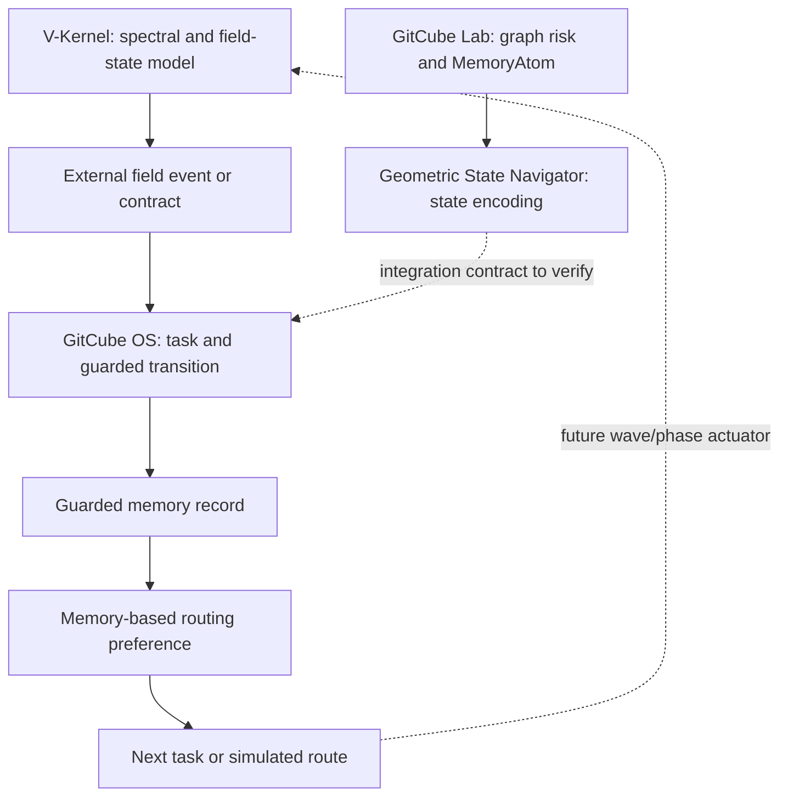
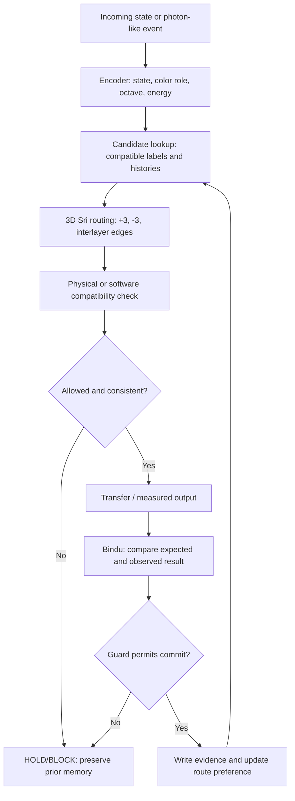

# 242 — 3D Sri–Octave Selective Memory: Resonant Exchange, Cross-Octave Matching, and the Four-Repository Bridge

**Project:** Vuzol-19 / World Theory / V-Kernel / GitCube Lab / Geometric State Navigator / GitCube OS  
**Suggested GitHub path:** `world_theory/242_3D_SRI_OCTAVE_KARMIC_MEMORY_SELECTIVE_ATOM_EXCHANGE_EN.md`  
**Continues:** [241 — 3D Sri–Octave Phase Routing and Atomic-State Hypothesis](./241_3D_SRI_OCTAVE_PHASE_ROUTING_ATOM_HYPOTHESIS_EN.md)  
**Status:** `RESEARCH / COMPUTATIONAL MODEL / TOY SIMULATION / ATOMIC ANALOGY UNDER TEST`  
**Language:** English  
**Updated:** 2026-10-19  
**Keywords:** selective resonance, color matching, octave indexing, karmic memory, MemoryAtom, photon absorption, emission, energy exchange, routing bias, 3D Sri, +3/-3, observable history, guarded update, GitCube OS.

> **Central extension beyond File 241:** The Sri network is not only a configurable set of wave paths. It can also maintain **transition memory that selects, blocks, or reweights future paths**. A state first finds compatible candidates, then a physics-aware or algorithm-aware Gate checks whether an actual transition is allowed. The result is measured and stored; the next input enters a network whose *effective decision topology* has changed.
>
> **Scientific limit:** This is a model of *memory-guided routing inspired by resonant systems*. It does **not** establish that ordinary atoms carry semantic color labels, record a donor's identity in a photon, or implement a GitCube-like policy engine. A successful toy simulation establishes the behavior of the implemented rules, not a new theory of atomic structure.

---

## 0. Why this is a continuation instead of a rewrite of File 241

File 241 already specifies the Flower's forward/reverse graph operators, the 3D Sri-inspired layout, the `14 -> 10 -> 10 -> 8 -> Bindu` partition, phase-sensitive gates, octaves, and initial engineering tests. **Those definitions remain in force.**

The following discoveries and design clarifications emerged **after** that file:

| New subject | Contribution to the architecture | Experimental status |
| --- | --- | --- |
| Karmic / transition memory | Past accepted or rejected routes reweight future choices. | Implementable software model. |
| Color-to-color recognition | Match candidate states by *functional label*, even across octaves. | Proposed search rule, not a law of matter. |
| Seven octaves by six roles | `7 x 6 = 42` labeled memory addresses. | Definable data structure. |
| Sri's 42 noncentral regions | A distinct 42-region geometric representation. | Geometric convention; equivalence to the 42 addresses requires an explicit mapping. |
| Octave change as re-representation | May change state description, available operations, connection graph, and memory scope together. | Proposed multiscale algorithm. |
| Real resonance absorption | Emitted radiation can be absorbed by a different atom if an allowed receiver transition matches. | Established physics. |
| Donor–receiver exchange | Emission, propagation, absorption, excitation, relaxation/re-emission form a testable interaction chain. | Established physical processes; simplified here. |
| Learning from failed exchange | A software controller avoids a previously unsuccessful path. | Confirmed in the toy test below. |
| Memory in GitCube OS | D56 write, D57 recall, D58 bias, D59 dispatch change, D60 guard policy. | Repository artifacts and source code inspected; not a photonic hardware test. |
| Memory in GitCube Lab | `MemoryAtom`, DNA key, phase-state encoding, risk-based action ranking. | Source implementation inspected. |
| Navigator-to-Lab bridge | Subprocess transfers structural-risk results into a state representation. | Concrete code bridge found. |
| Provenance and safety | Remember which route was taken, what evidence justified it, and who may commit. | Defined software guard discipline. |

**Do not silently merge these two different meanings of 42:** `7 octave indices x 6 color roles` is an **address space**; `14 + 10 + 10 + 8` counts **noncentral geometric regions**. An explicit bijection may be explored as an engineering choice, but matching cardinality is not evidence of natural identity.

## 1. A corrected reading of “red catches red”

The user-facing phrase means:

> A state tagged with one functional identity looks first for another state with a compatible identity, including at a different octave or structural scale. **The label identifies a candidate, not an automatic physical bond.**

In the Vuzol-19 six-role alphabet:

| Role address | Intended software meaning | Example candidate query |
| --- | --- | --- |
| `RED` | Pressure, danger, unstable residual | Find similar pressure patterns across levels. |
| `ORANGE` | Flow and movement | Find routes with compatible dynamics. |
| `YELLOW` | Structure and connection | Find matching topological constraints. |
| `GREEN` | Balance and coherence | Find aligned stabilization patterns. |
| `BLUE` | Rules, limits, validation | Find compatible guard conditions. |
| `VIOLET` | Future options, predictions | Find related prospective transitions. |

The colors are **semantic tags in the program**. In actual optics, “red light” is a wavelength/frequency range; atomic resonances depend on exact energy differences, linewidth, polarizations, and transition rules. **Two things that are both visually red need not resonate**, and dissimilar chemical species can exchange excitation when their transitions are compatible.

### 1.1 Search, compatibility, permission, consequence

A useful four-stage protocol is:

```text
ADDRESS   same or compatible color/role?       -> Candidate set
RESONANCE matching physical/graph state?       -> Compatibility score
GATE      permitted transition and constraints? -> ALLOW / HOLD / BLOCK
MEMORY    record observed consequence?          -> Future route adjustment
```

A strict role-matching prototype can use a Kronecker delta:

```math
C_{ij} = \delta_{c_i,c_j}.
```

A more general system can learn or specify a **compatibility matrix** `C[c_i,c_j]` with entries in `[0,1]`. A strict diagonal matrix is a software design choice; it must be tested against permissive/off-diagonal controls.

A candidate route score may be expressed as:

```math
Q_{ij}(t) = C_{ij}\,R_{ij}\,G_{ij} + \beta M_{ij}(t) - \lambda K_{ij},
```

where `R` is state compatibility, `G` a gate indicator, `M` memory-derived route preference, and `K` cost or risk. This is an **algorithmic scoring rule**, not a measured quantum transition amplitude. An additive bias permits memory to improve candidate ordering, but a hard physical or policy gate still has final authority.

**Non-negotiable constraint:** Memory may change which route is *attempted*, but may not override a forbidden transition or turn a frequency mismatch into real atomic absorption.

## 2. Octaves are changes of representation, not automatically a frequency ladder

An octave transition in the conceptual model can simultaneously transform:

1. **Representation:** raw event -> grouped structure -> stabilized pattern.
2. **Action space:** different candidates or control operators become available.
3. **Connection graph:** new interlayer or virtual links may be consulted.
4. **State encoding:** amplitude/time data may be summarized into phase, topology, or guarded decisions.
5. **Memory horizon:** broader-scale patterns can use summaries of earlier local interactions.

Let the representation at octave `o` be:

```math
S_o = (x_o,G_o,m_o,a_o), \qquad S_{o+1} = T_o(S_o),
```

where `x_o` is state, `G_o` its connection graph, `m_o` memory context, and `a_o` available actions.

**Important:** The higher level is not guaranteed to be more deterministic or contain all lower-level information. Coarse-graining often discards detail. Store reversible provenance or a lower-level pointer when auditability is required.

### 2.1 Proposed 7 x 6 memory address space

```text
             RED  ORANGE  YELLOW  GREEN  BLUE  VIOLET
O1 input      R1     O1      Y1     G1    B1      V1
O2 coupling   R2     O2      Y2     G2    B2      V2
O3 grouping   R3     O3      Y3     G3    B3      V3
O4 balance    R4     O4      Y4     G4    B4      V4
O5 invariants R5     O5      Y5     G5    B5      V5
O6 integration R6    O6      Y6     G6    B6      V6
O7 decision   R7     O7      Y7     G7    B7      V7
```

The repeated letters are *human-readable role aliases*, not chemical element symbols. Each address is an indexed state type rather than a separate physical atom or a different photon color.

If one prefers octaves `O0` through `O7`, the system has **eight** indexed levels. To preserve the seven-octave canonical choice, reserve `O0` as an **input/adapter** and use `O1`–`O7` for the seven levels above.

### 2.2 Cross-octave recognition

Examples:

- `RED@O1` = local error.
- `RED@O4` = related group-level contradiction.
- `RED@O7` = an aggregate alert requiring an explicit guarded decision.

A cross-octave query can match all three while distinguishing their **different scopes**. This creates a *virtual* connection, not instantaneous physical energy transfer between distant devices or literal quantum energy levels.

### 2.3 Relationship to the Sri cascade

A proposed computational interpretation is:

| Sri region | Count | Function of the memory-aware Gate |
| --- | ---: | --- |
| Outer | 14 | Generate candidates and indexed evidence. |
| Middle I | 10 | Group candidates and test structural correspondence. |
| Middle II | 10 | Compare conflicting histories and error vectors. |
| Inner | 8 | Check invariants and candidate stability. |
| Central region | 1 | Integrate the locally selected result. |
| Bindu | 1 point, **not** an extra triangle | Validate, emit verdict, and authorize memory updates. |

The cascade is a **designed data-flow interpretation**, not an established physical reduction from 14 to 10 measured atomic degrees of freedom.

## 3. The new “karmic” rule: history changes future routing

In this document **karmic memory** means *consequence-conditioned state transition*, not mystical causation, biological inheritance, or a claim about photons remembering their sources.

A reusable rule is:

```math
M_{ij}(t+1) = (1-\rho)M_{ij}(t) + \eta\,r_{ij}(t),
```

where:

- `M_ij` is learned route preference;
- `rho` is forgetting/decay, from zero to one;
- `eta` is learning gain;
- `r_ij` is a verified benefit, failure penalty, or neutral outcome.

**Actual feedback must be measured rather than invented.** A successful spectral transfer might earn positive routing preference. A failed transfer or invalid gate should lower it. A state is never allowed to edit the canonical ledger merely because its internal score is high.

A complete memory record should include:

```text
address | prior_state | attempted_route | emitted_energy
receiver_state | observation | gate_verdict | transition_result
confidence | simulated_or_measured | provenance | next_route_bias
```

At the next interaction, the controller may choose a new route. In software, *the controller remembers*. The emitted photon does not carry a GitHub history or the donor's previous experience.

### 3.1 Shadow as actionable residual, not a natural force

In a numerical controller:

```math
\mathrm{Shadow}(t) = d\bigl(y_{\mathrm{measured}}(t),y_{\mathrm{predicted}}(t)\bigr).
```

A rising residual can trigger `-3 / diagnostic scan`, escalation to a broader octave, or `HOLD`. It is a **computed error signal**, not a separately discovered interaction in atomic physics.

A hysteresis guard prevents rapid oscillation:

```text
if shadow > high_threshold: HOLD + diagnostic route
elif shadow < low_threshold and evidence_is_good: ALLOW candidate update
else: maintain existing settings
```

The `+3` and `-3` modes need operational semantics. For a ring of **six** nodes, `j+3` and `j-3` have the same destination modulo 6. They can still differ by phase, direction, history, or interlayer trajectory, but not merely by the destination number. In an eight-node ring, they reach different destinations.

## 4. Actual atomic resonance: what is similar and what is not

### 4.1 A photon emitted by one atom may be absorbed by another

For an allowed electronic transition:

```math
E_\gamma = h\nu = E_{\mathrm{upper}} - E_{\mathrm{lower}}.
```

A simplified two-level process is:

```text
Atom A excited -> Atom A relaxed + photon
Photon reaches Atom B in an appropriate lower state
Atom B absorbs (if energetically and quantum-mechanically allowed)
Atom B becomes excited
Atom B later relaxes or participates in another interaction
```

This is consistent with the [Harvard sodium resonance absorption demonstration](https://sciencedemonstrations.fas.harvard.edu/presentations/resonance-radiation-absorption). Sodium radiation is absorbed by sodium vapor because the relevant lines coincide; the specific mercury-lamp lines in the comparison do not drive the same transition.

However, **“same atom type” is not the criterion**. Even identical atoms may fail to absorb if the receiver is not in an appropriate state or the radiation is detuned. Different atomic or molecular species can interact where compatible transitions exist.

### 4.2 Energy mismatch and linewidth

A useful idealized resonance *lineshape* for angular-frequency detuning `Delta = omega - omega_0` is:

```math
L(\Delta)=\frac{\Gamma^2}{\Gamma^2+4\Delta^2},
```

with positive linewidth `Gamma` in angular-frequency units. It expresses frequency selectivity; it is **not** a complete absorption probability. That also depends on transition dipoles/matrix elements, polarization, propagation geometry, receiver populations, and intensity.

An actual absorption gate requires, at minimum:

- A receiver with an available initial state.
- Photon energy matching an allowed transition within the relevant linewidth.
- Nonzero transition coupling and acceptable polarization/selection rules.
- An interaction probability that incorporates light–matter coupling and geometry.

Reference: [NIST selection rules and line strengths](https://www.nist.gov/pml/atomic-spectroscopy-compendium-basic-ideas-notation-data-and-formulas/atomic-spectroscopy) and [NIST Atomic Spectra Database](https://www.nist.gov/pml/atomic-spectra-database).

### 4.3 Resonant *transfer* need not involve a free photon

Between close molecular donors and acceptors, **Förster resonance energy transfer (FRET)** can move electronic excitation without emission and subsequent absorption of a propagating free photon. It depends on donor-emission/acceptor-absorption spectral overlap, geometry, orientation, and separation.

This is a different transport model. A Sri-inspired simulator should have a separate mechanism tag:

- `RADIATIVE` = free photon emitted, propagated, possibly absorbed.
- `NEAR_FIELD` = modeled local donor–acceptor coupling (e.g., a justified FRET analogue).
- `COLLISIONAL` = a separate particle/atom collision model.

These must not be mixed into one unexplained “exchange of memory.”

Reference: [NIH / NCBI FRET assay guidance](https://www.ncbi.nlm.nih.gov/books/NBK464632/).

### 4.4 Why an atom is *not* a GitCube MemoryAtom

Real atoms can store *physical state*: ground/excited-state occupation, spin polarization, metastable population, correlations, or state changes due to their environment. Ordinary photon emission and absorption, however, do not by themselves implement a general-purpose growing history table that biases future decisions according to semantic color or success/failure.

Do not confuse:

| Thing called “memory” | What is retained | Scientific status |
| --- | --- | --- |
| Excited atomic state | Temporary population or coherence | Established quantum physics. |
| Metastable or spin state | Physical state over a finite lifetime | Established, system-dependent. |
| History-dependent medium | Reconfigured material response, hysteresis, bleaching, etc. | Established in specific materials. |
| GitCube MemoryAtom | Software record of a measured or validated transition | Implemented data model. |
| “Karmic” memory of an ordinary atom | Permanent semantic record of all past encounters | **Not demonstrated**. |

**No literal nuclear phase-router conclusion follows from a toy exchange model.** Protons and neutrons affect energy levels through established nuclear and electromagnetic physics, not verified 0/1 triangle switches.

## 5. Example: two atoms exchanging excitation, one detuned control

To test the design rather than assuming the conclusion, consider one *source* and two possible *receivers*:

| Object | Ring node | Role tag | Transition gap (toy units) | Initial role |
| --- | ---: | --- | ---: | --- |
| A | 0 | Red | 1.00 | Excited source, prepared again for each trial. |
| B | 3 | Red | 1.00 | Ground-state resonant receiver. |
| C | 5 | Red | 1.30 | Ground-state detuned receiver/control. |

All three have the **same semantic RED address**, but B and C have different transition energies. The photon is prepared with `E = 1.00` toy energy unit. On an eight-node ring:

```math
R_{+3}(0)=3\quad\text{(B)},\qquad R_{-3}(0)=5\quad\text{(C)}.
```

This gives us **two kinds of selection**:

1. A *physical-style* resonance test: B passes; C fails at the chosen detuning tolerance.
2. A *software* memory test: which of the two destinations should the controller attempt next?

### 5.1 Controlled observation: memory off versus on

The toy controller starts with equal route preferences. Its deterministic tie-breaker selects C first. After a failure, the memory-enabled version penalizes that route, then tries the other one.

| Trial | No memory: route, outcome | Memory ON: route, outcome | Learned weights after memory trial |
| ---: | --- | --- | --- |
| 1 | `-3 -> C`, not absorbed | `-3 -> C`, not absorbed | `B=0, C=-1` |
| 2 | `-3 -> C`, not absorbed | `+3 -> B`, absorbed and idealized re-emission | `B=1, C=-1` |
| 3 | `-3 -> C`, not absorbed | `+3 -> B`, absorbed and idealized re-emission | `B=2, C=-1` |

**Executed toy result:** zero successful absorptions for the fixed repeated-choice baseline; two in three trials for the simple memory-based router. Both were run with identical candidate energies and starting conditions. It is a **constructed demonstration**, not an experimentally measured atomic advantage.

The physical-style selection rule did **not** change when memory was turned on. Instead, the controller **stopped proposing the detuned route**. The gain therefore comes from remembered *routing*, not from changing nature's transition rules.

### 5.2 Reproducible standard-library Python toy

Save the following code as `sri_memory_exchange_toy.py` if running it separately. It also runs when copied from this Markdown block. All results shown above were generated from the same logic.

```python
"""Deterministic software demonstration; not a quantum-atomic simulator."""

N = 8
SOURCE = 0
NODES = {
    "B": {"node": 3, "role": "red", "gap": 1.00},
    "C": {"node": 5, "role": "red", "gap": 1.30},
}
PHOTON_ENERGY = 1.00
TOLERANCE = 0.05  # Artificial resonance cutoff, not a spectral line shape.


def choose_route(weights):
    # Equal scores deliberately select C; learning can correct that choice.
    return max(("C", "B"), key=lambda name: weights[name])


def trial(weights, use_memory):
    chosen = choose_route(weights)
    target = NODES[chosen]
    direction = "+3" if chosen == "B" else "-3"
    expected_node = (SOURCE + (3 if direction == "+3" else -3)) % N
    assert expected_node == target["node"]

    # Each trial externally prepares A in an excited state first.
    # A emits one toy-energy photon. The candidate either absorbs it or not.
    emitted = 1
    absorbed = int(
        target["role"] == "red"
        and abs(PHOTON_ENERGY - target["gap"]) <= TOLERANCE
    )
    reemitted = absorbed  # Idealized immediate relaxation after absorption.
    escaping = emitted - absorbed + reemitted
    assert emitted == escaping + absorbed - reemitted

    if use_memory:
        weights[chosen] += 1 if absorbed else -1

    outcome = "ABSORB+REEMIT" if absorbed else "NO_ABSORPTION"
    return direction, chosen, outcome, dict(weights)


def run(use_memory):
    weights = {"B": 0, "C": 0}
    return [trial(weights, use_memory) for _ in range(3)]


if __name__ == "__main__":
    for enabled in (False, True):
        print("MEMORY=" + ("ON" if enabled else "OFF"))
        for t, (route, target, result, weights) in enumerate(run(enabled), 1):
            print(
                f"trial={t} route={route} receiver={target} "
                f"outcome={result} weights={weights}"
            )

    assert [x[2] for x in run(False)] == ["NO_ABSORPTION"] * 3
    assert [x[2] for x in run(True)] == [
        "NO_ABSORPTION", "ABSORB+REEMIT", "ABSORB+REEMIT"
    ]
    print("Toy assertions: PASS")
```

**Verified terminal output (abbreviated):**

```text
MEMORY=OFF
trial=1 route=-3 receiver=C outcome=NO_ABSORPTION weights={'B': 0, 'C': 0}
trial=2 route=-3 receiver=C outcome=NO_ABSORPTION weights={'B': 0, 'C': 0}
trial=3 route=-3 receiver=C outcome=NO_ABSORPTION weights={'B': 0, 'C': 0}
MEMORY=ON
trial=1 route=-3 receiver=C outcome=NO_ABSORPTION weights={'B': 0, 'C': -1}
trial=2 route=+3 receiver=B outcome=ABSORB+REEMIT weights={'B': 1, 'C': -1}
trial=3 route=+3 receiver=B outcome=ABSORB+REEMIT weights={'B': 2, 'C': -1}
Toy assertions: PASS
```

**Model omissions:** no photon linewidth distribution, spontaneous decay lifetime, cross sections, polarization, quantum superposition, state-vector propagation, optical phase, finite transfer loss, or probabilistic detection. `reemitted = absorbed` is a pedagogical idealization; in an experiment radiative/nonradiative channels must be modeled separately. The source is **externally re-excited for each trial** and the energy balance therefore includes that preparation energy.

### 5.3 What would falsify the stronger thesis?

The algorithmic claim fails if:

- comparable conventional routers learn as well or better under matched resources;
- memory improves only because we deliberately chose an adversarial tie-breaker;
- the advantage disappears under noisy signals, new receivers, or changing transitions;
- supposed “same-color” compatibility predicts worse than measured spectral energy and selection-rule matching.

**Next improvement:** randomize initial route choice, repeat across many seeds, compare regret and transfer efficiency, then add realistic transfer probabilities rather than hard thresholds.

## 6. Separating three distinct interaction timescales

| Mechanism | What changes | Does the change survive when the signal is removed? |
| --- | --- | --- |
| **Photon absorption** | Receiver occupation or coherence. | Finite atomic relaxation/coherence time; not necessarily permanent. |
| **Software learning** | Route weights, candidate ranking, review record. | Yes, if reliably stored in the configured datastore. |
| **Material actuation** | Refractive index, phase-change state, configuration of a component. | Depends on the material, environment, and device design. |

These mechanisms can be coupled but **are not interchangeable**. A physical photon emission does not, by itself, commit a durable GitCube state. Conversely, a GitCube record is not a new photon or a measured nuclear transition.

## 7. What the existing four repositories really supply

### 7.1 V-Kernel — field and phase *model*

Relevant files:

- [V-Kernel start-here](https://github.com/pozdnyavladimer-jpg/v-kernel/blob/main/docs/V_KERNEL_START_HERE.md).
- [Photonic mapping](https://github.com/pozdnyavladimer-jpg/v-kernel/blob/main/docs/PHOTONIC_MAPPING.md).

Its notebook/specification lineage includes spectral exchange, cascade, coherence clock, honeycomb lattice, memory wave, resonance loop, decay/reinforcement, attention, and working-memory models. It defines `6 directions x 7 octaves = 42` spectral state addresses.

**Do not represent this as an already fabricated or measured photonic chip.** The current Sri memory-aware router is a proposed additional control layer over the field-processing model.

### 7.2 GitCube Lab — structure-aware MemoryAtoms and transition scoring

Relevant files:

- [MemoryAtom implementation](https://github.com/pozdnyavladimer-jpg/gitcube-lab/blob/main/memory/atom.py).
- [Transition history](https://github.com/pozdnyavladimer-jpg/gitcube-lab/blob/main/memory/transitions.py).
- [Memory policy and learned action scoring](https://github.com/pozdnyavladimer-jpg/gitcube-lab/blob/main/agent/memory_policy.py).

A MemoryAtom can contain a normalized structural `dna_key`, metrics, phase-direction information, a derived phase state, and content-derived identity. The policy calculates action-family performance using transitions' changes in risk:

```math
\Delta R = R_{\mathrm{before}} - R_{\mathrm{after}}.
```

That permits a later program to favor historically useful corrections. **It is not evidence that an individual physical atom stores SHA-256 IDs or a JSONL ledger.**

### 7.3 Geometric State Navigator — interpret the structural result

Relevant files:

- [GitCube bridge](https://github.com/pozdnyavladimer-jpg/geometric-state-navigator/blob/main/kernel/gitcube_bridge.py).
- [Canonical pipeline](https://github.com/pozdnyavladimer-jpg/geometric-state-navigator/blob/main/kernel/pipeline.py).

The bridge invokes GitCube Lab's risk exporter as a Python process and passes graph input/output as data. The pipeline converts the returned risk into a six-component state representation and applies policy thresholds. Several example decision metrics are predefined in the current pipeline; a risk-to-state mapping is **not** a complete physically grounded octave model.

### 7.4 GitCube OS — guarded write, recall, priority feedback

Relevant files:

- [D46–D61 field-memory loop](https://github.com/pozdnyavladimer-jpg/gitcube-os/blob/main/docs/D46_D61_FIELD_MEMORY_LOOP.md).
- [Experimental memory router](https://github.com/pozdnyavladimer-jpg/gitcube-os/blob/main/runtime_experimental/memory_router.py).
- [D59 dispatcher probe (verified branch)](https://github.com/pozdnyavladimer-jpg/gitcube-os/blob/auto/test-shadow-fix/reports/d59_memory_priority_bias_dispatch_probe.json).
- [Field memory example (verified branch)](https://github.com/pozdnyavladimer-jpg/gitcube-os/blob/auto/test-shadow-fix/memory/field_intent_memory.jsonl).

A real repository artifact records a guarded, simulated phase-resync case with:

| Field | Stored test value |
| --- | ---: |
| `memory_key` | `D3_O6` |
| `orbital_mode` | `HEX` |
| `field_case` | `PHASE_DRIFT_HEX` |
| `phase_error_before` | `0.340` |
| `phase_error_after` | `0.119` |
| D59 priority, before | `normal` |
| D59 priority, after | `critical` |

The D56–D59 chain records an outcome and uses it to influence **future software dispatch**. The numbers come from a program test/report and do not establish measured optical phase correction.

The D179 report on the checked `auto/test-shadow-fix` branch marks the proposal-reentry scope ready while setting `real_apply_executed = false` and requiring human review before applying changes. D179 is evidence of guarded state/report processing, **not autonomous permission to execute real patches**. A D180 artifact was not located on that branch during this review; do not infer its GitHub publication solely from a local screenshot.

### 7.5 Integration status: four roles, not one verified continuous runtime



**Confirmed component bridges are not proof of a full always-on four-repository loop.** A true end-to-end system needs a versioned event schema, actual subprocess/API orchestration, shared trace IDs, guarded authorizations, and a regression test spanning all four repositories.

## 8. A clean 3D Sri memory-aware machine architecture

Combine File 241's spatial graph with the new memory gate:



Here Bindu means *readout + decision policy*; it is **not** a physical singularity. If a real photonic device is eventually built, the readout and gate logic will ordinarily be implemented with detectors and an electronic controller.

### 8.1 Three address spaces must remain separate

1. **Sri address:** `(ring, triangle_region, node, z_layer)`.
2. **Memory address:** `(octave, color_role, dna_key, case_id)`.
3. **Physical-spectral address:** `(frequency, polarization, allowed_transition, receiver_state)`.

A mapper relates these address spaces, but identical text labels do not turn a software `RED` tag into a photon of red wavelength.

### 8.2 Two visible projections, one hidden difference

As proposed in File 241, two 3D graphs may have the same top-view projection but distinct internal edges and phases. Their different future output histories can become evidence in memory. Additional measurements may distinguish them. This is **observability / inverse-model identification**, not a literal solution to quantum uncertainty.

### 8.3 Why the Colosseum analogy remains useful

The Colosseum analogy clarifies **independent yet coupled networks**: a building's arches transmit loads, corridors route people, and staircases couple levels. For Sri:

- spatial pathways carry amplitudes or data;
- control lines set coupler parameters;
- memory lines store and retrieve evidence;
- cross-level links exchange summaries or physical signals under allowed conditions.

One geometry can host different functional graphs. Physical optical, electrical, and memory channels must be separately specified in hardware.

## 9. Proposed machine-readable exchange contract

For a future **non-executing** cross-repository experiment, use a versioned event such as:

```json
{
  "schema": "vuzol19.selective_exchange.v0",
  "event_id": "sim-case-001",
  "origin": "toy_sri_router",
  "mode": "SIMULATION_ONLY",
  "emitter": {"id": "A", "node": 0, "excited": true},
  "receiver": {"id": "B", "node": 3, "gap": 1.0},
  "signal": {"energy": 1.0, "role_tag": "RED", "octave": "O3"},
  "route": {"direction": "+3", "z_layer": 0},
  "gate": {"status": "ALLOW", "reason": "toy_resonance_match"},
  "observation": {"absorption_event": true, "experiment": false},
  "memory": {"write_requested": true, "route_bias_delta": 1},
  "safety": {
    "network_allowed": false,
    "real_apply_allowed": false,
    "human_review_required_for_apply": true
  }
}
```

The signal role tag is **controller metadata**. It should not be described as hidden information carried by the physical photon in this toy test. A measured physical experiment would require calibrated units, spectra, timestamps, uncertainties, and detector provenance.

Suggested gate discipline:

```text
PROPOSE event
  -> VALIDATE schema
  -> CHECK source provenance and physical plausibility
  -> RUN simulator / read observations
  -> SCORE consequences and shadow residual
  -> REQUEST guarded memory update
  -> COMMIT only if explicit policy allows
  -> AUDIT preserved previous state + diff
```

Avoid overwriting canonical memory while exploring a hypothesis. Use side-by-side or append-only experimental stores with replayable input seeds.

## 10. Research matrix: how to test without confusing analogy with discovery

| Track | Model | Baseline | What to measure | What a success actually means |
| --- | --- | --- | --- | --- |
| A. Software learning | 8-node routes, two receivers | Memory-off and random routing | Absorption proxy, regret, retries | A learned route chooses compatible receivers faster. |
| B. Spectral realism | Physical transition frequencies and linewidths | Frequency-only reference | Predicted spectra vs. measured NIST data | Software predicts known spectral selectivity. |
| C. 3D / octave graph | Sri-inspired graph with role/octal addresses | Matched-degree hex/mesh/random graphs | Cost, fidelity, crosstalk, observability | A topology-specific engineering advantage. |
| D. Memory ablation | Same network with/without route history | No-memory controller | Recovery after changed coupling or drift | Memory improves adaptation under controlled drift. |
| E. Atomic novelty | Explicit new quantum operator | Conventional atomic Hamiltonian | New line splitting/shift/selection-rule prediction | A genuinely testable atomic hypothesis **only if confirmed independently**. |

**Controls required:** same number of nodes, optical components, controller state, observation budget, noise model, allowed training examples, and physical constraints. A result from Track A cannot automatically establish Track E.

### 10.1 Core falsifiable claims

- **C1 — Cross-octave retrieval:** indexing by compatible roles and learned context improves retrieval or route choice over a well-tuned conventional search baseline.
- **C2 — Learned exchange:** route history reduces wasted transmissions without changing the established transition physics.
- **C3 — Guarded stability:** Bindu/Shadow feedback reduces repeated error or false-green outcomes without unacceptable latency.
- **C4 — Topology benefit:** the 3D Sri-inspired graph exhibits measurable advantage after matching connection count and component resource budget.
- **C5 — Atomic claim:** any proposed physical Sri operator predicts an independently measurable spectroscopic deviation; otherwise the atomic mapping remains analogy/HOLD.

### 10.2 Adversarial cases

1. Same color label, wrong photon energy: **do not absorb**.
2. Different role label, physically allowed transition: a physics model **must not forbid** the transition solely because of a semantic tag.
3. Receiver already excited in a closed two-level absorption test: respect state populations; consider stimulated emission separately.
4. Disallowed parity/selection rule: **do not claim absorption from frequency matching alone**.
5. History says success but current resonance has drifted: real-time constraints win over past memory.
6. Six-node ring `+3/-3`: do not count duplicate destinations as distinct routes unless phase/path metadata really differs.
7. No audit evidence: `HOLD`, not silent `ALLOW`.
8. Memory corruption or stale branch: reject/mark uncertain; do not fabricate provenance.

## 11. Engineering tasks proposed after File 241

| Step | Small deliverable | Required outcome |
| --- | --- | --- |
| `M0` | Frozen eight-node selective-exchange toy | Reproduce table and assertions above. |
| `M1` | Add probabilistic resonance and finite lifetimes | Validate normalization and energy-budget accounting. |
| `M2` | Add `7x6` role/octave lookup | Compare strict-color, compatibility-matrix and no-color baselines. |
| `M3` | Add full Sri `14/10/10/8` graph | Map each role address explicitly; avoid numeric coincidence claims. |
| `M4` | Add mutable 3D interlayer routes + phases | Check linear optical transfer constraints and path observability. |
| `M5` | Connect experimental records to GitCube Lab | Emit MemoryAtom/TransitionStore-compatible test artifacts. |
| `M6` | Connect Navigator risk scoring and GitCube OS gate | Verify the controller respects HOLD/BLOCK and produces traceable decisions. |
| `M7` | Run ablations / noise and concept-drift tests | Publish failures as well as successes. |
| `M8` | Optional photonic demonstrator | Build real MZI/coupler model with measurable phase tuning and losses. |
| `M9` | Optional separate atomic-theory test | Specify Hamiltonian + numerical spectra + independent data test. |

**Do not turn on** real apply, shell execution by AI, secret reads, or provider/network access in the D179/D180 controlled-autonomy path just to run these simulations. A read-only, offline experiment is sufficient.

## 12. Updated truth table: FACT / MODEL / HYPOTHESIS / REJECT

| Claim | Status | Rationale |
| --- | --- | --- |
| Atoms absorb photons selectively at allowed resonances. | **FACT** | Directly established experimentally and by atomic spectroscopy. |
| Distinct atoms/molecules can exchange excitation. | **FACT** | Radiative pathways and, in suitable systems, near-field transfer. |
| An excited atom can later emit radiation. | **FACT** | Established quantum transition processes. |
| Atomic state influences its subsequent possible transitions. | **FACT** | Populations and selection rules constrain what can occur next. |
| A semantic same-color tag is an address for retrieval. | **MODEL** | Implementable software role matching. |
| MemoryAtoms can reweight software routing choices. | **MODEL / REPO EVIDENCE** | Source and D59 test artifacts support this behavior. |
| A 3D Sri/octave mesh might improve programmable wave computing. | **HYPOTHESIS** | Requires matched photonic/algorithmic benchmarks. |
| Natural photons preserve donor-specific GitCube-style histories. | **REJECT / NO EVIDENCE** | No demonstrated semantic donor ledger in an ordinary photon. |
| Nuclear proton-neutron arrangements are actual `+3/-3` Sri switches. | **HOLD** | No Hamiltonian, mechanism or distinct experimental prediction. |
| Simulation reproducing absorption proves the model *is an atom*. | **REJECT** | It reproduces programmed behaviors, not all quantum atomic physics. |
| `14+10+10+8=42` proves `7x6=42` describes nuclear nature. | **REJECT** | Equal counts do not establish physical equivalence. |

## 13. Connections to existing World Theory and GitHub files

### World Theory / Flower Gate

- [241 — parent: Sri/octave phase router](./241_3D_SRI_OCTAVE_PHASE_ROUTING_ATOM_HYPOTHESIS_EN.md)
- [192 — Flower Transition Memory Route Audit](./192_FLOWER_TRANSITION_MEMORY_ROUTE_AUDIT.md)
- [117 — Consciousness as Field Vector Octave Table](./117_CONSCIOUSNESS_AS_FIELD_VECTOR_OCTAVE_TABLE.md)
- [216 — Light–Current–Material Closed Loop](./216_LIGHT_CURRENT_MATERIAL_CLOSED_LOOP.md)
- [170 — Hexorama Octave Floor Routing](./170_HEXORAMA_OCTAVE_FLOOR_ROUTING_OPERATOR.md)
- [191 — Sri 14/10/10/8 Universal Gate Correction](./191_SRI_14_10_10_8_UNIVERSAL_SOUND_CURRENT_GATE_CORRECTION.md)
- [Flower Gate Core 21 — Consequence-aware 9V tensor](../00_FLOWER_GATE_CORE/21_FULL_CHAIN_REVIEW_AND_9V_CONSEQUENCE_TENSOR.md)

### Implementation repositories

- [V-Kernel — spectral states, memory-wave docs](https://github.com/pozdnyavladimer-jpg/v-kernel/blob/main/docs/V_KERNEL_START_HERE.md)
- [GitCube Lab — MemoryAtom](https://github.com/pozdnyavladimer-jpg/gitcube-lab/blob/main/memory/atom.py)
- [GitCube Lab — risk-based memory policy](https://github.com/pozdnyavladimer-jpg/gitcube-lab/blob/main/agent/memory_policy.py)
- [Navigator — GitCube risk bridge](https://github.com/pozdnyavladimer-jpg/geometric-state-navigator/blob/main/kernel/gitcube_bridge.py)
- [GitCube OS — closed-loop memory sequence](https://github.com/pozdnyavladimer-jpg/gitcube-os/blob/main/docs/D46_D61_FIELD_MEMORY_LOOP.md)
- [GitCube OS — memory bias to future dispatch](https://github.com/pozdnyavladimer-jpg/gitcube-os/blob/auto/test-shadow-fix/reports/d59_memory_priority_bias_dispatch_probe.json)
- [GitCube OS — guarded D179 proposal](https://github.com/pozdnyavladimer-jpg/gitcube-os/blob/auto/test-shadow-fix/reports/d179_controlled_autonomy_proposal_reentry_scope.json)

### Physical-science and hardware references

1. Harvard Natural Sciences Lecture Demonstrations — [Resonance Radiation/Absorption](https://sciencedemonstrations.fas.harvard.edu/presentations/resonance-radiation-absorption).
2. NIST — [Atomic Spectra Database](https://www.nist.gov/pml/atomic-spectra-database).
3. NIST — [Atomic Spectroscopy: Selection Rules and Intensities](https://www.nist.gov/pml/atomic-spectroscopy-compendium-basic-ideas-notation-data-and-formulas/atomic-spectroscopy).
4. NCBI/NIH — [FRET guidance](https://www.ncbi.nlm.nih.gov/books/NBK464632/).
5. On *et al.*, *Nature Communications* (2024) — [Programmable integrated photonics for topological Hamiltonians](https://doi.org/10.1038/s41467-024-44939-3).
6. GitHub — [Mathematical expressions](https://docs.github.com/en/get-started/writing-on-github/working-with-advanced-formatting/writing-mathematical-expressions) and [Mermaid diagrams](https://docs.github.com/en/get-started/writing-on-github/working-with-advanced-formatting/creating-diagrams).

---

## 14. Canon conclusion: the route becomes a memory-conditioned opportunity

> **Geometry proposes available routes.**  
> **Octaves select the level of representation.**  
> **Colors/roles retrieve compatible candidates.**  
> **Resonance and physics decide which physical interactions are possible.**  
> **Shadow exposes the difference between prediction and observation.**  
> **Bindu/Guard decides what may be committed.**  
> **Transition memory alters which permitted route is attempted next.**
>
> In software, this produces a **memory-conditioned programmable transition network**. In actual atoms, resonant absorption and state-dependent transitions are real, but a literal nuclear Sri/Karmic Memory mechanism is **not established**.

**Single recommended next experiment:** a preregistered comparison of memory-on versus memory-off selective routing across `7x6` state tags on the same 3D graph, with realistic spectral constraints, randomized seeds, audit logs, and identical computational budgets.

## Appendix — GitHub rendering and integrity rules

- This document uses **GitHub Flavored Markdown** without changing File 241 or any other repository file.
- Mermaid flowcharts are in fenced `mermaid` blocks with safe ASCII node IDs and quoted labels.
- Display formulas use fenced `math` blocks; do **not** paste LaTeX after unclosed list markers or mix triple-backtick fences.
- Python and JSON use independent fenced blocks and keep their own syntax.
- The tables use normal `|` separators, while `+3/-3` is plain routing notation.
- Markdown links to World Theory are relative to `world_theory/`; repository-specific code uses absolute GitHub URLs.
- The code in Section 5 is a reproducible software **toy**, not executable GitHub Actions or a demand for privileged automation.
- Some Android and mobile previews show raw Mermaid/math source even if GitHub's rendered Markdown view displays them correctly.

**Integrity:** Add this as File 242. Preserve File 241 and all D-files. No permissions, Git branches, runtime code, or memory ledgers are changed by creating the document.
